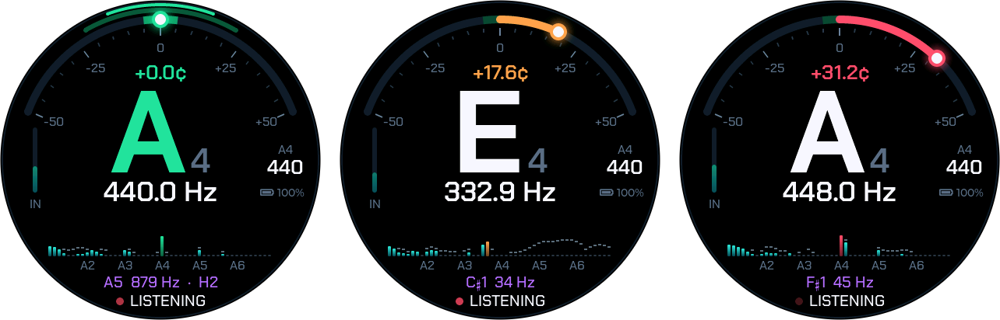

# Watcher Tuner

A chromatic tuner firmware for the Seeed Studio **SenseCAP Watcher**
(ESP32-S3, 412×412 round touch display, microphone, scroll wheel). Push the
wheel, play a note, and it shows the note, how many cents off it is, its
frequency, a live spectrum, and the strongest secondary frequency.



<sub>Screenshots taken from the device with `tools/snap.py`.</sub>

## Features

- **Accurate:** the McLeod Pitch Method, computed with FFTs, plus spectral
  refinement. Within 0.13 cents on test tones from 41 to 2000 Hz, and within
  ±0.05 cents for most tones played through the speaker into the mic.
- **The right octave:** strings whose 2nd harmonic is louder than the
  fundamental don't jump an octave, which plain FFT peak picking gets wrong.
- **Fast:** about 6 ms per analysis on the S3 with
  [esp-dsp](https://github.com/espressif/esp-dsp)'s radix-4 FFT, a fresh
  reading every 21 ms.
- **The display** (LVGL 9, about 45 fps): a cents gauge with a glowing needle
  and a ±5¢ zone, the note, its frequency, a 48-band spectrum from A1 to A7
  with the fundamental and the secondary peak marked, and the secondary's
  note and harmonic number (e.g. `A5 879 Hz · H2`).
- **Adjustable reference:** A4 from 415 to 466 Hz, saved across restarts.
- **Battery friendly:** listens only after a push, stops by itself after 20 s
  without a note, and holding the wheel powers it off.
- **A test console over USB:** play test tones on the speaker and log what the
  mic heard, take screenshots, record the mic.

## Controls

| | |
|---|---|
| Push the wheel, or tap the screen | start / stop listening (stops by itself after 20 s without a note) |
| Turn the wheel | reference pitch A4, 415–466 Hz (saved). It stops at 440 on the way through; any other value shows in amber, because it renames every note (440 Hz reads as G♯4 against A4 = 465) |
| Hold the wheel 2.5 s | power off (on USB: sleeps until the wheel is pushed) |

## Getting started

### Requirements

- A SenseCAP Watcher. The camera and Wi-Fi aren't used.
- [ESP-IDF **v6.1**](https://docs.espressif.com/projects/esp-idf/en/latest/esp32s3/get-started/).
  The component manager fetches the rest (LVGL 9.5, esp-dsp, esp_codec_dev,
  and the SPD2010 display and touch drivers); `dependencies.lock` pins the
  versions.

### Build

```sh
. $IDF_PATH/export.sh        # e.g. ~/esp/esp-idf-v6.1/export.sh
idf.py build
```

### Flash

```sh
tools/flash.sh                # or: tools/flash.sh /dev/cu.usbmodemXXXX3
```

The Watcher's CH342 USB bridge drops bytes when esptool sends whole packets,
so **`idf.py flash` fails**, and leaves the board without a bootloader until a
flash succeeds. `tools/paced_esptool.py` sends 64 bytes at a time at 115200
baud. It takes about a minute; don't interrupt it.

The bridge shows up as two serial ports. The ESP32-S3 is on the **second**
one: on macOS its name ends in `3`, which `flash.sh` finds by itself. On
Linux, pass the port.

### Flash layout, and going back

The Watcher keeps factory data (`nvsfactory`) in flash between `0x9000` and
`0x3AFFF`. The tuner's partition table (`partitions.csv`) leaves that range
alone and starts at `0x3B000`. **Never run `erase-flash` on this device.**
Other firmware's settings stored there (such as
[Muse](https://github.com/facebookincubator/muse-gadget-sdk)'s pairing and
Wi-Fi) also survive. To go back to another firmware, flash it as usual; it
brings its own bootloader and partition table.

## How it detects pitch

Audio comes in at 48 kHz. Every 1024 samples (21 ms), the last 4096 (85 ms)
are analyzed (`main/pitch.c`):

1. **One real FFT** of the zero-padded block (esp-dsp, radix-4, packed into
   a 4096-point complex FFT).
2. **Spectrum:** the Hann-windowed spectrum is derived from that same FFT in
   the frequency domain (0.5·X[k] − 0.25·X[k±2]), so it needs no FFT of its
   own. It feeds the histogram, the peak list and the secondary frequency.
3. **Period:** the power spectrum → a second FFT → autocorrelation
   (Wiener–Khinchin) → the McLeod Pitch Method's normalized square difference
   function. MPM picks the right octave even when a string's 2nd harmonic is
   louder than its fundamental.
4. **Frequency:** refined from the spectral peaks of the fundamental and its
   first harmonics (power-weighted, with a fitted correction for the
   interpolation bias). The autocorrelation integrates noise across the whole
   band; on the Watcher's mic, room noise pulled it 8–17 cents sharp, and the
   spectral refinement takes that to about 0.
5. **Two notes a fifth apart** repeat at a "virtual" octave below. When the
   period has no energy at its own frequency, the strongest real peak wins.

The UI then needs two agreeing readings to change notes, takes the median of
the last five, and eases the needle.

### Measured

| | |
|---|---|
| Analysis time on the S3 | ~6 ms per 4096-sample block (FFT: 1.4 ms) |
| Synthetic tones 41–2000 Hz | ≤ 0.13 cents |
| Harmonic "strings", E1–C6 | ≤ 0.04 cents, no octave errors |
| Speaker → mic on the device, 330–1320 Hz | ≤ 0.7 cents (most ±0.05) |
| Recorded 440 / 330 Hz tones at −44 / −51 dBFS in room noise | +0.00 / −0.01 cents mean |

The speaker can't play low notes, so below 330 Hz the tuner has only been
tested on synthetic signals.

## Serial console and tools

The console (115200 baud, on the same port as flashing) takes commands:

| | |
|---|---|
| `tone <hz> [ms] [volume]` | play a sine on the speaker (and listen) |
| `sweep` | play G3…E6 on the speaker, log what the mic heard |
| `listen` / `stop` | start / stop listening |
| `a4 <hz>` | set the reference |
| `stat` | memory, frame rate, analysis time |
| `bench` | time the FFT and a full analysis |
| `snap` | dump the screen |
| `rec [n] [hz]` | dump raw mic samples, optionally over a tone |

The tools need pyserial, which the ESP-IDF environment has:

```sh
tools/console.py sweep -t 20           # talk to the board without resetting it
tools/console.py --reset -t 5          # reset it and show the boot log
tools/snap.py screen.png               # screenshot
tools/rec.py take.wav --tone 440       # record the mic
```

The mic is the right I2S slot. The left one carries the speaker's output (an
echo-cancellation loopback), so a test tone shows up there as a perfect
digital copy.

## Host tests

The pitch detector also builds on the host (`test/fft_host.c` stands in for
esp-dsp):

```sh
make -C test run                                  # synthetic signals
make -C test analyze_wav && test/analyze_wav take.wav 440   # a recording
```

## Project layout

| | |
|---|---|
| `main/pitch.c` | FFT + MPM pitch detection, spectrum, peaks |
| `main/fft_dsp.c` | esp-dsp FFT (`test/fft_host.c` on the host) |
| `main/audio.c` | I2S, ES7243E mic and ES8311 speaker codecs, capture task |
| `main/ui.c` | LVGL screen |
| `main/display.c` | SPD2010 QSPI panel, LVGL glue, touch |
| `main/board.c` | PCA9535 expander rails, wheel, backlight, battery |
| `main/main.c` | input handling, console |
| `main/fonts/` | bitmap fonts, generated by `fonts/build_fonts.sh` |
| `fonts/src/` | the source fonts and their licenses |
| `tools/` | flashing, console, screenshot and recording scripts |
| `test/` | host tests |

## Credits

- Pins and power sequencing follow Seeed's SenseCAP Watcher BSP and the
  Watcher board support in Meta's
  [muse-gadget-sdk](https://github.com/facebookincubator/muse-gadget-sdk),
  which is also where `tools/paced_esptool.py` comes from (Apache 2.0).
- The pitch detection is based on Philip McLeod and Geoff Wyvill, "A Smarter
  Way to Find Pitch" (ICMC 2005).
- Fonts: [Chakra Petch](https://github.com/m4rc1e/Chakra-Petch) and
  [Noto Music](https://github.com/notofonts/music), under the SIL Open Font
  License 1.1.

## License

Copyright 2026 Sascha Häberling. Licensed under the
[Apache License 2.0](LICENSE).

The fonts in `fonts/src/`, and the bitmap fonts in `main/fonts/` generated
from them, are under the [SIL Open Font License 1.1](fonts/src/OFL-ChakraPetch.txt),
not Apache 2.0.
